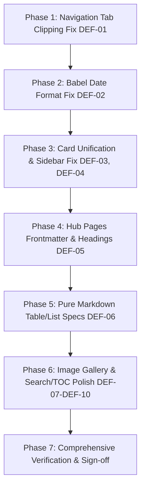

# UI/UX Revamp Roadmap: Defect Remediation & Polish
**Execution Blueprint:** Step-by-Step Implementation, Verification & Final Checklist  
**Version:** 2.1 (Deep-Dive Remediation)  
**Target:** `pixelatedpenmanship.github.io`  
**Reference Document:** [SPEC.md](SPEC.md)  

---

## 1. Phase-by-Phase Remediation Plan



---

### Phase 1: Navigation Tab Clipping & Descender Remediation (DEF-01)
**Goal:** Give tabs sufficient height, remove forced vertical padding, and implement a floating active underline that never clips letters ('g', 'y', 'p').

1. **Update `.md-tabs` in `docs/stylesheets/extra.css`:**
   - Expand `.md-tabs__item` to `height: 2.75rem`.
   - Remove `padding: 0.75rem 1rem !important` from `.md-tabs__link`.
   - Set `.md-tabs__link` to `height: 100%; display: inline-flex; align-items: center; padding: 0 0.85rem !important; margin-top: 0 !important;`.
   - Replace the clipped `border-bottom: 2px solid ...` with an absolute positioned pseudo-element (`::after`) at `bottom: 0`, with rounded ends (`border-radius: 9999px; height: 2.5px; background: var(--pp-accent-nib)`).
2. **Verify in Browser:** Check "Writing" ('g'), "Technology" ('g'/'y'), and "About & Portfolio" ('p') across viewports.

---

### Phase 2: Babel Date Format Rectification (DEF-02)
**Goal:** Eliminate "Day of Year" dates ("February 33", "March 89", "November 318") across the blog.

1. **Update `mkdocs.yml`:**
   - Change `post_date_format: MMMM D, YYYY` to:
     ```yaml
     post_date_format: MMMM d, yyyy
     ```
   - In Babel formatting, lowercase `d` represents Day of Month (1–31).
2. **Verify Build Output:** Inspect `site/blog/index.html` and single post headers to verify dates render correctly as `February 2, 2026` and `March 30, 2025`.

---

### Phase 3: Card Architecture Unification & Article Sidebar Fix (DEF-03 & DEF-04)
**Goal:** Ensure all cards share the same modern 10px rounded design and remove unintended card styles from article sidebars.

1. **Scope Blog Excerpts in `docs/stylesheets/extra.css`:**
   - Change `.md-post` to `.md-post--excerpt` so it only targets post list items on `/blog/`.
   - Explicitly reset `.md-sidebar--post .md-sidebar__inner.md-post` (border: none, background: transparent, padding: 0).
2. **Style Hub Grid Cards (`.grid.cards`):**
   - Apply identical 10px radius, 1px hairline border (`var(--pp-border-subtle)`), 1.5rem padding, and 2px hover lift to `.md-typeset .grid.cards > ul > li` and `.md-typeset .grid.cards > ol > li`.

---

### Phase 4: Hub Pages Editorial Elevation (DEF-05)
**Goal:** Remove raw emoji prefixes from H1 titles and establish proper YAML frontmatter for browser tab titles and SEO.

1. **Update `docs/writing/index.md`:**
   - Add frontmatter:
     ```markdown
     ---
     title: Writing Instruments
     description: Hands-on reviews of nibs, feeds, filling mechanisms, and pen craftsmanship.
     ---
     ```
   - Update heading: `# Writing Instruments & Craftsmanship`.
2. **Update `docs/tech/index.md`:**
   - Add frontmatter:
     ```markdown
     ---
     title: Technology
     description: Systems engineering, embedded security roadmaps, operating system internals, and developer tools.
     ---
     ```
   - Update heading: `# Systems Engineering & Technology`.

---

### Phase 5: Pure Markdown Specs & Image Gallery Polish (DEF-06 & DEF-08)
**Goal:** Deliver elegant review specification sheets from standard Markdown tables without requiring any inline HTML `<div>` tags in user notes.

1. **Add Markdown Table & Definition List Styles to `extra.css`:**
   - Style `.md-typeset table:not([class])` with 8px radius, subtle borders, monospace uppercase header labels (`var(--pp-accent-nib)`), and clean spacing.
   - Style `.md-typeset dl`, `.md-typeset dt`, and `.md-typeset dd` for clean horizontal key-value specs.
2. **Polish Post Images (`.md-typeset img`):**
   - Add `border-radius: 8px; border: 1px solid var(--pp-border-subtle); box-shadow: 0 4px 16px -4px rgba(0, 0, 0, 0.06);`.

---

### Phase 6: Secondary Navigation & Search Polish (DEF-07, DEF-09, DEF-10)
**Goal:** Ensure the Table of Contents, search dropdown, and content boundaries look unified in both Light and Dark modes.

1. **Table of Contents Styling:**
   - Style `.md-nav--secondary .md-nav__link` with comfortable line height and active indicator highlight (`var(--pp-accent-nib)`).
2. **Search Dropdown Parity:**
   - Ensure `.md-search__output` and `.md-search-result__item` match `--pp-surface-card` and have crisp readable text in both themes.
3. **Content Margins:**
   - Refine `.md-content__inner` max-width rules so multi-column layouts remain balanced.

---

## 2. Verification & Testing Procedures

### 2.1 Automated Build Validation
```bash
# Clean build in strict mode (fails on ANY broken link, exclusion, or syntax error)
mkdocs build --strict --clean

# Verify date string formatting across generated HTML files
python3 -c "
with open('site/blog/index.html') as f:
    text = f.read()
import re
dates = re.findall(r'<time datetime=\"[^\"]+\">(.*?)</time>', text)
print('Sample dates in blog index:', dates[:5])
for d in dates:
    assert 'February 33' not in d, 'Error: Invalid day of year found in date!'
    assert 'March 89' not in d, 'Error: Invalid day of year found in date!'
print('Date verification passed!')
"
```

### 2.2 Visual Inspection Checklist
1. **Tabs Bar:**
   - Verify letters `g` (Writing), `y` (Technology), and `p` (About & Portfolio) have clear vertical space between baseline and tab container border.
   - Verify active tab indicator has clean pill ends and doesn't overlap letters.
2. **Card Consistency:**
   - Check `/writing/`, `/tech/`, `/blog/`, and `/`—all cards must have matching 10px rounded corners and identical hover behavior.
3. **Single Article View:**
   - Open `/blog/2025/03/30/penbbs-355--more-than-a-cheap-conid-knockoff/`.
   - Verify the left sidebar (Back to index, Metadata, Table of Contents) has no card border or hover effect.
   - Verify review photos have subtle rounded corners and clean borders.
4. **Theme Parity:**
   - Toggle Light Mode: Verify warm archival paper canvas (`#fbf9f5`), crisp white cards, and readable text.
   - Toggle Dark Mode: Verify terminal obsidian canvas (`#0d1117`), elevated cards (`#161b22`), and luminous nib accents.

---

## 3. Final Sign-off Checklist

- [x] DEF-01: Tab descenders completely unclipped across all viewports.
- [x] DEF-02: `MMMM d, yyyy` date format fixed in `mkdocs.yml`; no day-of-year dates rendered.
- [x] DEF-03: `.grid.cards` on `/writing/` and `/tech/` match `.md-post--excerpt` design language.
- [x] DEF-04: Single article sidebar (`.md-sidebar--post`) freed from `.md-post` card styling.
- [x] DEF-05: Frontmatter and clean editorial headings added to `docs/writing/index.md` and `docs/tech/index.md`.
- [x] DEF-06: Pure Markdown tables and definition lists styled as bespoke specification sheets.
- [x] DEF-07: `.md-content__inner` flex alignment and reading width harmonized.
- [x] DEF-08: Review gallery images styled with 8px radius and hairline borders.
- [x] DEF-09: Secondary Table of Contents contrast and active states polished.
- [x] DEF-10: Search modal results styled consistently with theme cards.
- [x] DEF-11: Subpage relative asset paths resolved; avatar loads with HTTP 200 on `/about/`.
- [x] DEF-12: 4-space indentation removed under markdown="1" blocks, eliminating raw code blocks.
- [x] `mkdocs build --strict --clean` passes with **0 warnings and 0 errors**.
